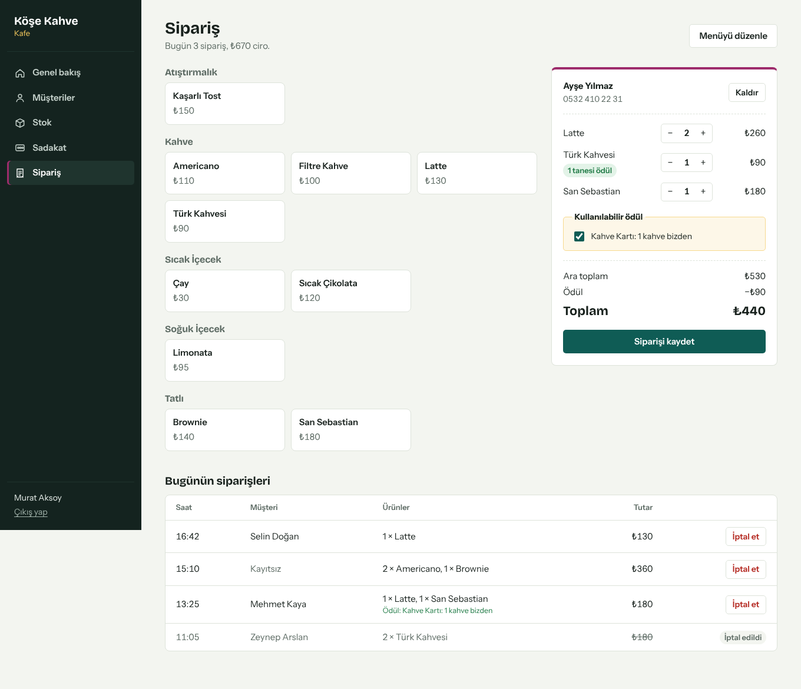
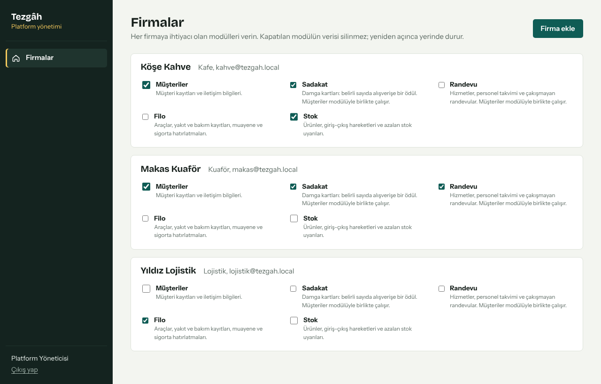
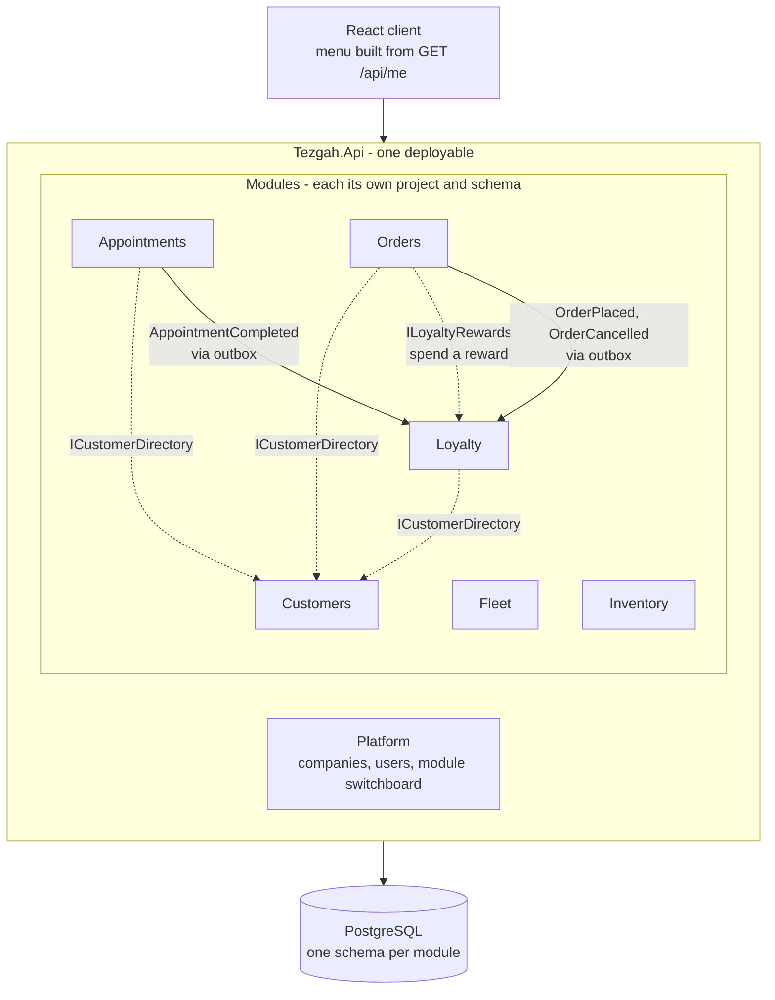

# Tezgâh

[](https://github.com/emrecanAy/tezgah/actions/workflows/ci.yml)

One platform for small businesses, sold module by module. A hairdresser gets customers, a stamp card and appointments; a café gets a till, the stamp card and stock; a logistics firm gets only fleet tracking. Same code base, same database, and each company sees only what it was given.

.NET 10 modular monolith, React 19, PostgreSQL. The UI is in Turkish.



| Café: stamp cards | Hairdresser: appointments |
|---|---|
|  |  |
| **Logistics: fleet** | **Platform admin: who gets what** |
|  |  |

## Modules

| Module | What it does | Needs |
|---|---|---|
| **Müşteriler** (customers) | Customer records, one per phone number per company | |
| **Sipariş** (orders) | Menu and till. The till sends what was ordered; the amounts come from the menu. A loyalty reward is spent here and shows up in the total | Customers |
| **Sadakat** (loyalty) | Stamp cards with a rule the company defines: "every 4 haircuts, one free", "every 4 coffees, one on us". Stamps are earned only from recorded sales and completed visits, never by hand: per item (optionally of one category), per order, or per appointment | Customers |
| **Randevu** (appointments) | Services, staff, a day agenda. A staff member cannot be double-booked | Customers |
| **Filo** (fleet) | Vehicles, fuel and maintenance logs, consumption, alerts for inspection, insurance and service dates | |
| **Stok** (inventory) | Products, stock in/out movements, low-stock warnings | |

## Two ways to choose modules

**Per company, at runtime.** The platform administrator ticks the modules each company has. Turning one off closes it immediately (`403 module_not_enabled`) but keeps its data, so turning it back on loses nothing. Dependencies are enforced: loyalty cannot be given without customers.

**Per installation, at start-up.** `Platform:Modules` lists the modules a deployment ships. A customer who bought only fleet tracking gets an installation where the other modules are never registered: no endpoints, no tables.

```bash
docker compose -f compose.yaml -f compose.fleet.yaml up --build
```

## Run it

Requirements: Docker.

```bash
docker compose up --build
```

Open http://localhost:8080. The first start creates three demo companies with data. The login page lists their accounts:

| Account | Password | Modules |
|---|---|---|
| `makas@tezgah.local` (hairdresser) | `demo1234` | Customers, Loyalty, Appointments |
| `kahve@tezgah.local` (café) | `demo1234` | Customers, Orders, Loyalty, Inventory |
| `lojistik@tezgah.local` (logistics) | `demo1234` | Fleet |
| `admin@tezgah.local` (platform admin) | `admin1234` | Opens companies, assigns modules |

API reference: http://localhost:5080/docs

### Things to try

- Sign in as the café, open **Sipariş**, pick the customer Ayşe Yılmaz and add a latte and a Türk kahvesi. Her coffee card is full, so a reward is offered: tick it and the cheaper coffee goes free. Save, then open **Sadakat**: the paid coffee is on her card. Cancel the order in today's list and both the stamp and the reward go back.
- Sign in as the hairdresser, open **Randevu**, click an appointment and mark it **Tamamlandı**. Then open **Sadakat**: the customer's card has a new stamp. The two modules do not know each other.
- Try to book the same staff member for an overlapping time. The second booking is refused.
- Sign in as the admin, give Yıldız Lojistik the **Stok** module, then sign in as Yıldız Lojistik: it appears in the menu.

### Working on the code

```bash
docker compose up -d postgres

dotnet run --project src/Tezgah.Api     # API on http://localhost:5080  (.NET 10 SDK)
cd web && npm install && npm run dev    # web on http://localhost:5173  (Node 22)
```

```bash
dotnet test                             # needs Docker: Testcontainers starts PostgreSQL
cd web && npm run lint && npm test
```

## Architecture



**A module is a project that implements `IModule`.** It registers its services, maps its endpoints, owns its migrations and can seed demo data. The host lists the modules once; everything else (routing, the per-company gate, migrations, seeding) loops over that list. Adding another module means one project and one line in `Program.cs`.

**Modules never reference each other.** They compile against `Tezgah.Core` only and talk through it: `ICustomerDirectory` for looking up customers, `ILoyaltyRewards` for spending a reward at the till, integration events for "something happened". An installation without Loyalty gets an empty `ILoyaltyRewards`, so the till does not care whether it exists. `ArchitectureTests` fails the build if a module references another module or exposes anything but its `IModule` class.

**Multi-tenancy in one place.** Module data implements `ITenantOwned`. The shared `TenantDbContext` stamps the company on insert and adds a query filter on every query, so module code never writes `Where(x => x.TenantId == ...)` and cannot forget it. Reading tenant data without a tenant throws instead of returning everything.

**The module gate in one place.** Every module's endpoints are mounted under `/api/{module}` behind one filter that checks the company's selection. A module cannot leave an endpoint open by mistake.

**Events respect the selection too.** When an appointment is completed, Appointments publishes `AppointmentCompleted` through its outbox. The dispatcher runs Loyalty's handler only if that company has Loyalty, inside that company's tenant scope. A hairdresser without a stamp card gets no loyalty data.

**A stamp is a consequence, not an action.** There is no endpoint that stamps a card. Orders saves a sale and its `OrderPlaced` event in one transaction; Loyalty turns the event into as many stamps as the program's rule says, keyed by the order. Cancelling the order publishes `OrderCancelled`, which takes the stamps back and returns a reward the order spent. A stamp therefore always points at a sale that exists.

**Spending a reward is a direct call.** It changes the price, so it cannot wait for an event. The till claims the reward through `ILoyaltyRewards` with the order's id, then saves the order. If the save fails the claim is released; if the same order is sent again the claim is found and not repeated.

## Correctness under concurrency

Small businesses have two tills and a phone, and the same thing does happen twice at once.

| Situation | Guard | Test |
|---|---|---|
| Ten receptionists book the same 10:00 slot for the same stylist | PostgreSQL `EXCLUDE USING gist (staff_id WITH =, tstzrange(starts_at, ends_at) WITH &&)`. Cancelled appointments do not block | `Ten_people_booking_the_same_slot_at_once_produce_exactly_one_appointment` |
| Two tills ring up orders for the same customer at the same moment | Every change to a customer's cards runs under a PostgreSQL advisory lock on that customer (`pg_advisory_xact_lock`). A row lock would not do: the first stamps race to create a card that has no row yet | `Stamps_from_orders_rung_up_at_the_same_moment_are_all_counted` |
| One reward spent from several tills | Same lock; the reward is claimed before the order is saved | `One_reward_spent_from_several_tills_at_once_goes_to_one_order` |
| A double tap or a retry sends the same order again | The till chooses the order id: the primary key stops the second insert, the reward claim and the stamps are keyed by it | `The_same_order_sent_several_times_at_once_is_recorded_and_stamped_once` |
| A retried stamp event arrives after the order was cancelled | The cancellation leaves a mark in Loyalty; a late stamp for that order is refused | `A_stamp_arriving_after_its_order_was_cancelled_is_refused` |
| Two tills cancel the same order | `xmin` concurrency token: one wins, the event goes out once | `An_order_cancelled_from_two_tills_at_once_is_cancelled_once` |
| Thirty sales of the last ten items | One conditional `UPDATE ... SET stock = stock - n WHERE stock - n >= 0`, plus a `CHECK (stock >= 0)` | `Thirty_people_taking_one_item_each_from_a_stock_of_ten_empty_it_exactly` |
| An event delivered twice | Each stamp records its source (`order:{id}`, `appointment:{id}`), unique per card; a second delivery finds it and does nothing | `Completing_an_appointment_stamps_the_customers_loyalty_card_exactly_once` |
| One company reading another's data | Tenant query filter; foreign ids answer 404 | `TenantIsolationTests` |

## Repository layout

```
src/
  Tezgah.Api/              composition root: the module list, auth, migrations at start-up
  Tezgah.Core/             IModule, ModuleCatalog, tenancy, outbox, Result, cross-module contracts
  Tezgah.Platform/         companies, users, sign-in (JWT), admin endpoints, demo companies
  Modules/
    Tezgah.Customers/
    Tezgah.Loyalty/
    Tezgah.Appointments/
    Tezgah.Fleet/
    Tezgah.Inventory/
    Tezgah.Orders/
tests/Tezgah.Tests/        integration tests on real PostgreSQL, module catalog, architecture rules
web/                       React + TypeScript + Vite + TanStack Query, one folder per module
```

## Deliberately left out

- **Staff accounts and roles inside a company.** Each company has its owner account. Roles exist in the token but every company user can do everything in the modules they have.
- **Payments.** The till records what was sold and for how much; taking the money is outside.
- **Orders taking stock out of Inventory.** Menu items and stock products are separate lists. Linking them (a latte uses 18 g of beans and 200 ml of milk) is a recipe feature of its own.
- **Billing.** Which modules a company pays for is the admin's checkbox, not a subscription system.
- **Working hours and online self-booking.** The agenda shows 09:00 to 20:00 and bookings are made by staff.
- **SMS or e-mail reminders** for appointments and fleet due dates.

## License

MIT
